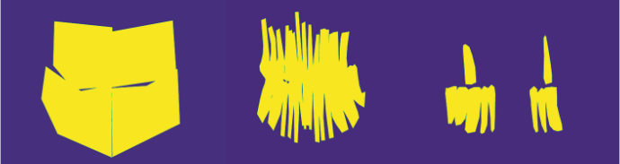
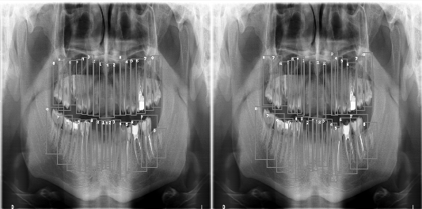
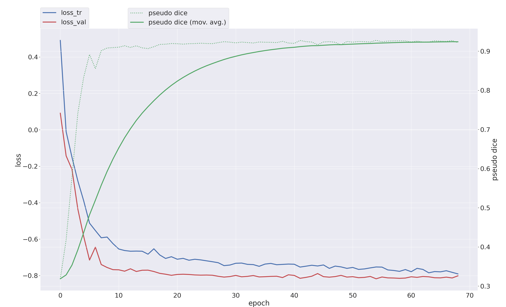

# Dr. SAM: DENTEX from the nnSAM Perspective

**Tooth segmentation, enumeration and diagnosis on panoramic dental X-rays**
Image Segmentation course project, M.Sc. Computer & Systems Engineering, Alexandria University (Fall 2023)
Momen Ibrahim Fawzy · Menna ElKammah · supervised by Prof. Marwan Torki

Reading a panoramic X-ray is slow and error-prone even for specialists. The
[DENTEX challenge](https://dentex.grand-challenge.org/) (MICCAI 2023) asks a model to find every tooth, number it
with the FDI system and flag abnormal teeth (caries, deep caries, periapical lesions, impacted teeth). The labels
are hierarchical and only partly annotated:

| Level | X-rays | Labels |
|---|---|---|
| 1 | 693 | quadrant |
| 2 | 634 | quadrant + tooth enumeration |
| 3 | 705 train (+ 50 val, 250 test) | quadrant + enumeration + diagnosis |
| – | 1,571 | unlabeled |

This project turns the box/polygon annotations into segmentation problems and compares a **U-Net** with **nnSAM**,
a frozen Segment-Anything encoder plugged into nnU-Net.


*Training masks generated from the annotations for the three tasks: quadrant, enumeration and disease.*

---

## Pipeline

1. **Masks** (`dentex/data/coco.py`): DENTEX polygons are rasterised into one label map per task
   (4 quadrant, 32 tooth and 4 diagnosis classes), and every pair is resized to 512×512.
2. **Mask refinement** (`dentex/data/refine.py`): neighbouring teeth overlap in the annotations, so a semantic
   network merges them. Each tooth is grown by 6 px and its intersection with already-drawn teeth is cut out,
   leaving a gap between neighbours. An explicit **border class** is then added: erode 1 px, dilate by 5 px, and
   label the band in between.
3. **Models**
   - **U-Net** (`dentex/models/unet.py`), one model per task. The course experiments trained a binary U-Net
     (tooth vs background, `--binary`) with Adam, batch size 4, 35 epochs, an 80/20 split, and horizontal flip plus
     5% salt-and-pepper augmentation. The rewrite also supports multi-class training (one class per quadrant, tooth
     or diagnosis) with a Dice + cross-entropy loss. Flip augmentation then swaps left/right quadrant labels
     (`labels.hflip_lookup`) so it stays anatomically correct.
   - **nnSAM** (`dentex/nnsam.py`, `scripts/run_nnsam.sh`): SAM's ViT encoder (frozen) and nnU-Net's encoder run in
     parallel, and their features are concatenated into nnU-Net's decoder. One nnU-Net v2 dataset per task
     (Dataset043/044/045), 5-fold cross-validation, 70 X-rays held out for testing.
4. **Instances** (`dentex/postprocess/instances.py`): tooth cores (tooth minus border) are labelled and grown back
   to full teeth, which gives a tooth count per X-ray.
5. **Boxes** (`dentex/postprocess/boxes.py`): per label, the connected-component areas are clustered with DBSCAN and
   the dominant cluster becomes the box. This removes stray fragments without an area threshold. Lesions get one
   box each and are linked to the tooth they overlap.
6. **Export** (`dentex/export.py`): COCO-style results with the hierarchical DENTEX categories, ready for
   AP / AP50 / AP75 / AR.

## Results

**nnSAM, validation Dice per fold** (5-fold cross-validation)

| Task | Fold 0 | Fold 1 | Fold 2 | Fold 3 | Fold 4 |
|---|:---:|:---:|:---:|:---:|:---:|
| Quadrant | **0.9243** | 0.9217 | 0.9214 | 0.9027 | 0.8980 |
| Enumeration (32 teeth) | **0.7563** | 0.7490 | 0.7240 | 0.6674 | 0.6460 |
| Disease | **0.5781** | 0.5122 | 0.4671 | 0.3810 | 0.3012 |

**Binary U-Net (tooth vs background), Keras, as run in the course**

| Setting | Measured on | Accuracy | Recall | Specificity | PPV | NPV | IoU | F1 |
|---|---|:---:|:---:|:---:|:---:|:---:|:---:|:---:|
| Tooth U-Net of Helli & Hamamci, reproduced on its 116-image dataset | training (epoch 250) | 0.982 | 0.959 | 0.988 | 0.953 | 0.989 | 0.916 | 0.956 |
| Same model applied to DENTEX, no fine-tuning | DENTEX masks | 0.893 | 0.903 | 0.897 | 0.562 | 0.988 | 0.536 | 0.663 |
| Trained on DENTEX: quadrant | training (epoch 35) | 0.964 | 0.932 | 0.977 | 0.937 | 0.974 | 0.877 | 0.934 |
| Trained on DENTEX: quadrant + enumeration | training (epoch 35) | 0.947 | 0.873 | 0.963 | 0.832 | 0.972 | 0.741 | 0.851 |
| Trained on DENTEX: disease | training (epoch 35) | 0.963 | 0.295 | 0.991 | 0.584 | 0.971 | 0.232 | 0.371 |

The U-Net rows (except the no-fine-tuning row) are final-epoch training metrics. They show how well each mask type
can be fitted, not generalisation. The nnSAM Dice scores above are measured on held-out cross-validation folds.

What the numbers say:
- Tooth *presence* is easy: the U-Net fits quadrant masks at IoU 0.88, and nnSAM reaches validation Dice 0.92.
- Telling 32 teeth apart is much harder (validation Dice 0.76), because neighbouring teeth look alike and touch.
- Diagnosis is the bottleneck: lesions are small and rare, so even the training recall is only 0.30. This is where
  more data (the 1,571 unlabeled X-rays) or detection-style heads would help most.

| Ground truth vs nnSAM prediction (enumeration) | nnSAM training, quadrant fold 0 |
|---|---|
|  |  |

More figures are in [`docs/results.md`](docs/results.md).

---

## Repository layout

```
src/dentex/
  labels.py              task label spaces, FDI numbering, flip-safe label remapping
  data/coco.py           DENTEX JSON -> semantic and instance masks
  data/refine.py         overlap removal and the border class
  data/dataset.py        512x512 pairs, flip (label-aware) and salt-and-pepper augmentation
  models/unet.py         U-Net
  losses.py              Dice + cross-entropy
  metrics.py             accuracy, recall, specificity, PPV, NPV, IoU, F1/Dice
  engine.py              training with early stopping on validation Dice
  postprocess/           tooth instances; DBSCAN box extraction
  export.py              COCO-style predictions for the three levels
  nnsam.py               nnU-Net v2 raw datasets for nnSAM
scripts/  make_masks.py · train_unet.py · prepare_nnsam.py · run_nnsam.sh · predict.py
configs/unet.yaml
docs/     results.md · timeline.md · assets/
tests/    17 unit tests on synthetic data
```

## Usage

```bash
pip install -e ".[dev]"
# DENTEX data: https://huggingface.co/datasets/ibrahimhamamci/DENTEX  (CC BY-NC-SA 4.0, not redistributed)

python scripts/make_masks.py --task enumeration --refine overlap \
  --json data/DENTEX/training_data/quadrant_enumeration/train_quadrant_enumeration.json \
  --images data/DENTEX/training_data/quadrant_enumeration/xrays --out data/prepared/enumeration
python scripts/train_unet.py --config configs/unet.yaml --task enumeration --binary   # course setup
python scripts/train_unet.py --config configs/unet.yaml --task enumeration            # multi-class

pip install git+https://github.com/Kent0n-Li/nnSAM.git
python scripts/prepare_nnsam.py --prepared data/prepared --nnunet-raw nnsam/nnUNet_raw
bash scripts/run_nnsam.sh

python scripts/predict.py --from-masks --images data/test/xrays --sizes data/test/original_sizes.json \
  --quadrant nnsam/predictions/043 --enumeration nnsam/predictions/044 --disease nnsam/predictions/045 \
  --out results/nnsam_predictions.json

python -m pytest tests
```

## References
- I. E. Hamamci et al. *DENTEX: An Abnormal Tooth Detection with Dental Enumeration and Diagnosis Benchmark for Panoramic X-rays.* arXiv 2023.
- Y. Li et al. *nnSAM: Plug-and-play Segment Anything Model Improves nnUNet Performance.* arXiv 2023.
- F. Isensee et al. *nnU-Net: a self-configuring method for deep learning-based biomedical image segmentation.* Nature Methods 2021.
- A. Kirillov et al. *Segment Anything.* ICCV 2023.
- S. Helli, A. Hamamci. *Tooth Instance Segmentation on Panoramic Dental Radiographs Using U-Nets and Morphological Processing.* Düzce Univ. J. Sci. Technol. 2022.
- O. Ronneberger, P. Fischer, T. Brox. *U-Net: Convolutional Networks for Biomedical Image Segmentation.* MICCAI 2015.

Code in this repository: MIT licence. DENTEX data and the nnSAM / nnU-Net code keep their own licences.
