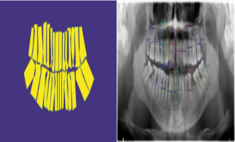
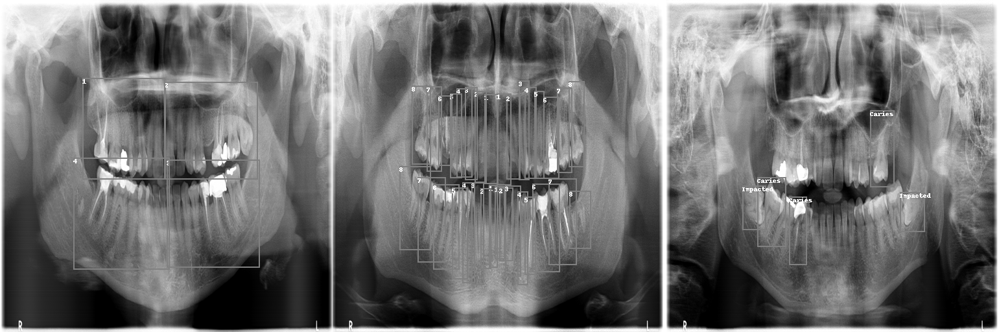
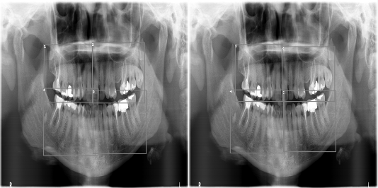
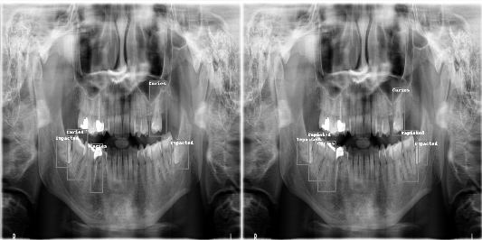

# Results in detail

## Mask refinement and the U-Net
U-Net results on the validation split for each stage of mask refinement (foreground vs background):

| Masks | Task | Accuracy | Recall | Specificity | PPV | NPV | IoU | F1 |
|---|---|:---:|:---:|:---:|:---:|:---:|:---:|:---:|
| raw polygons | quadrant | 0.964 | 0.932 | 0.977 | 0.937 | 0.974 | 0.877 | 0.934 |
| raw polygons | quadrant + enumeration | 0.947 | 0.873 | 0.963 | 0.832 | 0.972 | 0.741 | 0.851 |
| raw polygons | disease | 0.963 | 0.295 | 0.991 | 0.584 | 0.971 | 0.232 | 0.371 |
| overlaps removed | quadrant | 0.959 | 0.925 | 0.971 | 0.920 | 0.973 | 0.855 | 0.922 |
| overlaps removed | quadrant + enumeration | 0.927 | 0.816 | 0.948 | 0.747 | 0.965 | 0.639 | 0.779 |

Removing overlaps lowers the pixel scores slightly, because the masks now contain thin gaps that are hard to hit
exactly. The payoff is downstream: post-processing on raw-polygon predictions counted 13 teeth where there were
many more, because neighbouring teeth merged. The border class was introduced to fix exactly that.

## nnSAM
5-fold cross-validation, validation Dice:

| Task | Fold 0 | Fold 1 | Fold 2 | Fold 3 | Fold 4 |
|---|:---:|:---:|:---:|:---:|:---:|
| Quadrant | 0.9243 | 0.9217 | 0.9214 | 0.9027 | 0.8980 |
| Enumeration | 0.7563 | 0.7490 | 0.7240 | 0.6674 | 0.6460 |
| Disease | 0.5781 | 0.5122 | 0.4671 | 0.3810 | 0.3012 |

### Held-out test X-rays: ground truth (left) vs prediction (right)
| Quadrant | Disease |
|---|---|
|  |  |

## Next steps
- Compute AP / AP50 / AP75 / AR on the exported boxes with the official DENTEX evaluation container.
- Longer training per fold; the enumeration and disease folds were still improving when training stopped.
- Text prompts for SAM, and pre-training on the 1,571 unlabeled X-rays.
